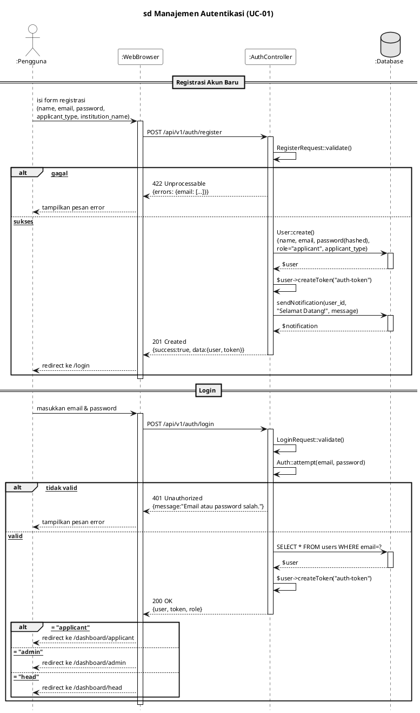
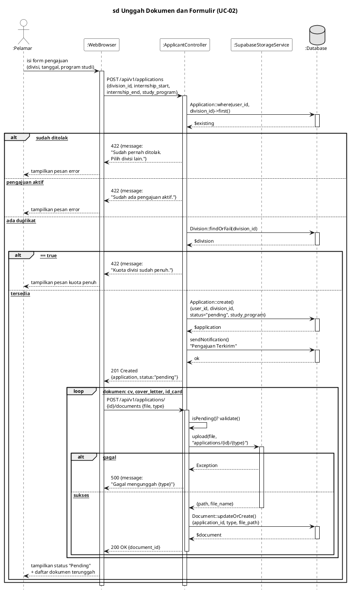
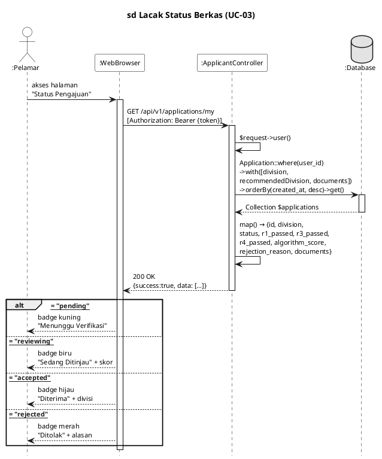
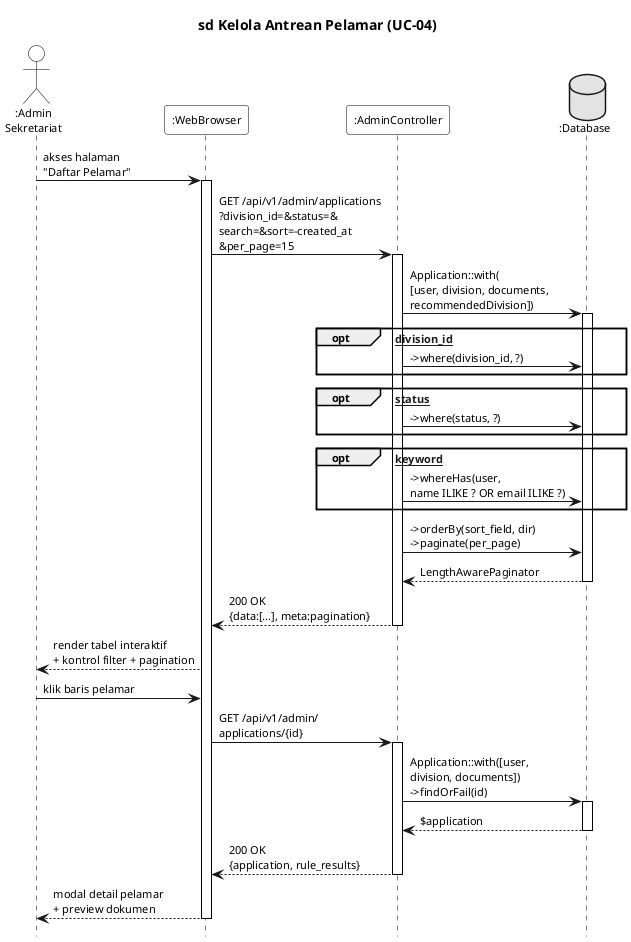
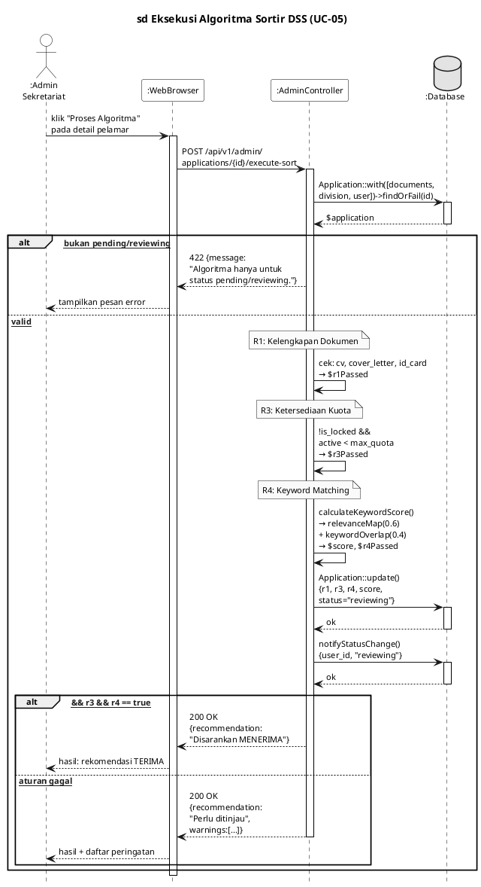

# 10 Sequence Diagram E-Internship — Part 1 (UC-01 s.d. UC-05)

> **Cara pakai:** Buka [plantuml.com](https://www.plantuml.com/plantuml/uml) → paste kode → unduh PNG → tempel ke Word
> **Font dokumen:** Arial 12

---

## SD-01 · UC-01 – Manajemen Autentikasi

### Kalimat Pengantar

Diagram *sequence* berikut menggambarkan skenario UC-01 (Manajemen Autentikasi) pada alur pendaftaran akun baru dan masuk (*login*), di mana AuthController memvalidasi kredensial melalui RegisterRequest dan LoginRequest, menyimpan data pengguna ke *database* PostgreSQL, membuat token autentikasi Sanctum, serta mengarahkan pengguna ke halaman *dashboard* sesuai peran (*applicant*, *admin*, atau *head*).

### PlantUML

---

## SD-02 · UC-02 – Unggah Dokumen & Formulir

### Kalimat Pengantar

Diagram *sequence* berikut menggambarkan skenario UC-02 (Unggah Dokumen & Formulir), di mana ApplicantController memeriksa duplikasi pengajuan dan ketersediaan kuota divisi, menyimpan data permohonan dengan status *pending*, mengunggah dokumen persyaratan (CV, Surat Pengantar, Kartu Identitas) ke Supabase Storage melalui SupabaseStorageService, serta mengirimkan notifikasi konfirmasi kepada Pelamar.

### PlantUML

---

## SD-03 · UC-03 – Lacak Status Berkas

### Kalimat Pengantar

Diagram *sequence* berikut menggambarkan skenario UC-03 (Lacak Status Berkas), di mana ApplicantController mengambil seluruh data pengajuan milik pelamar melalui relasi *Eloquent* (division, documents, recommendedDivision) dan menampilkan tahapan evaluasi secara dinamis meliputi status *pending*, *reviewing*, *accepted*, atau *rejected* beserta detail skor algoritma dan alasan penolakan.

### PlantUML

---

## SD-04 · UC-04 – Kelola Antrean Pelamar

### Kalimat Pengantar

Diagram *sequence* berikut menggambarkan skenario UC-04 (Kelola Antrean Pelamar), di mana AdminController menampilkan seluruh data pelamar dalam format tabel interaktif yang mendukung penyaringan berdasarkan divisi, status, dan tipe pelamar, pencarian berdasarkan nama atau email, serta pengurutan dinamis dan *pagination*.

### PlantUML

---

## SD-05 · UC-05 – Eksekusi Algoritma Sortir

### Kalimat Pengantar

Diagram *sequence* berikut menggambarkan skenario UC-05 (Eksekusi Algoritma Sortir), di mana AdminController mengevaluasi pengajuan secara otomatis melalui tiga aturan bisnis (R1: kelengkapan dokumen, R3: ketersediaan kuota divisi, R4: kesesuaian kata kunci menggunakan calculateKeywordScore()) lalu menghasilkan skor dan rekomendasi keputusan sebagai *Decision Support System* bagi Admin Sekretariat.

### PlantUML

