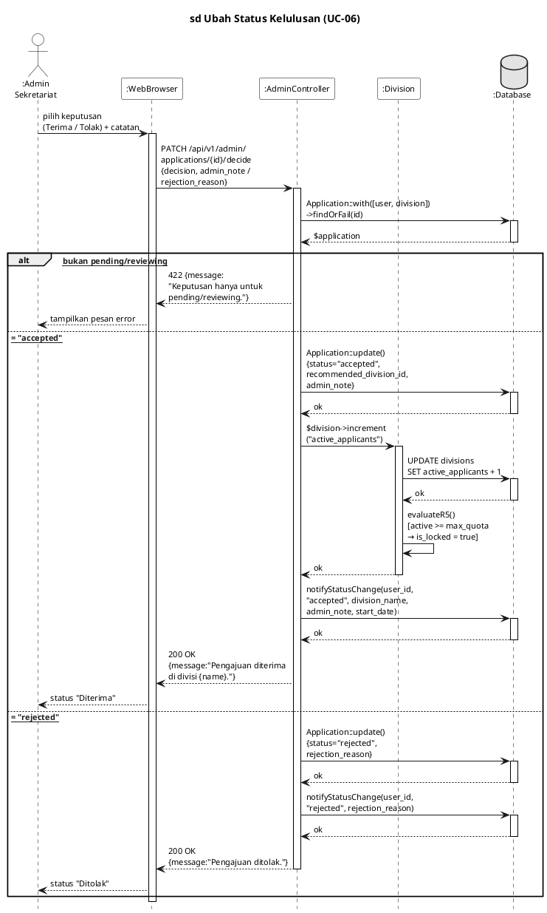
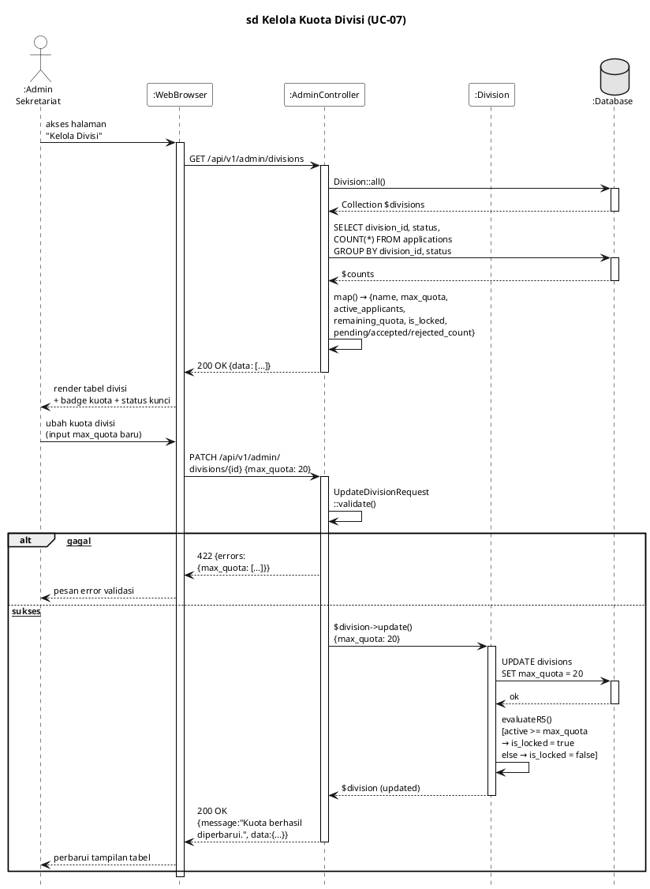
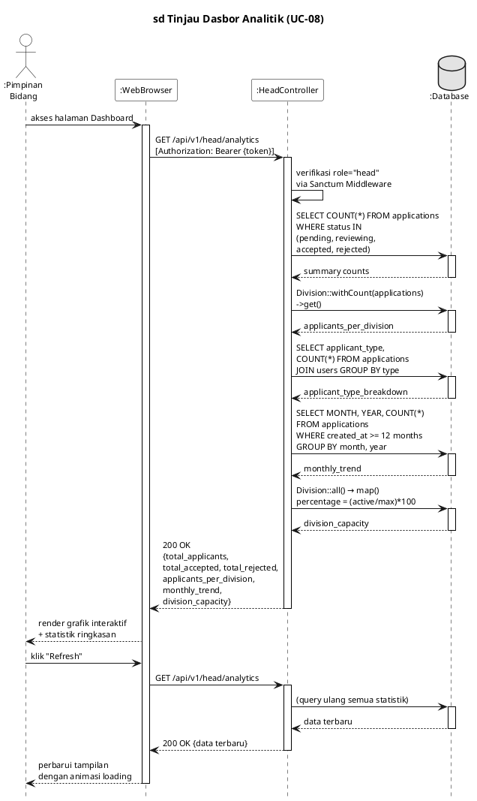
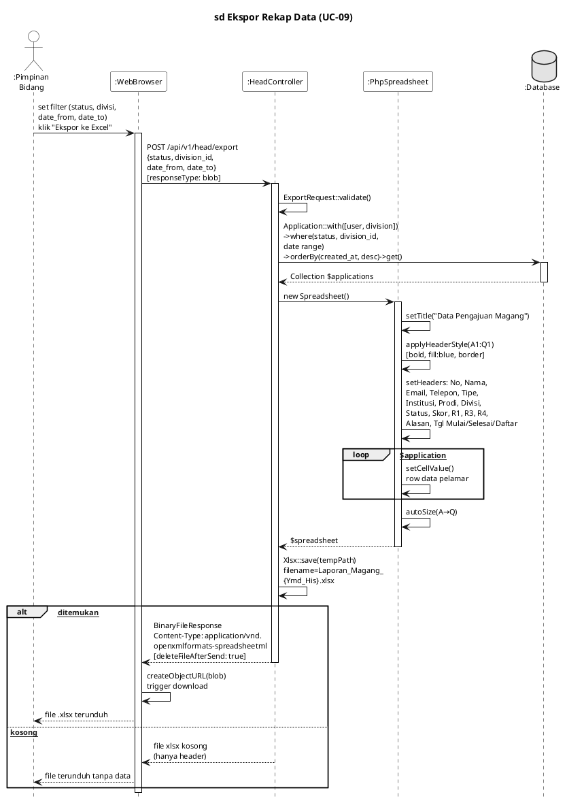
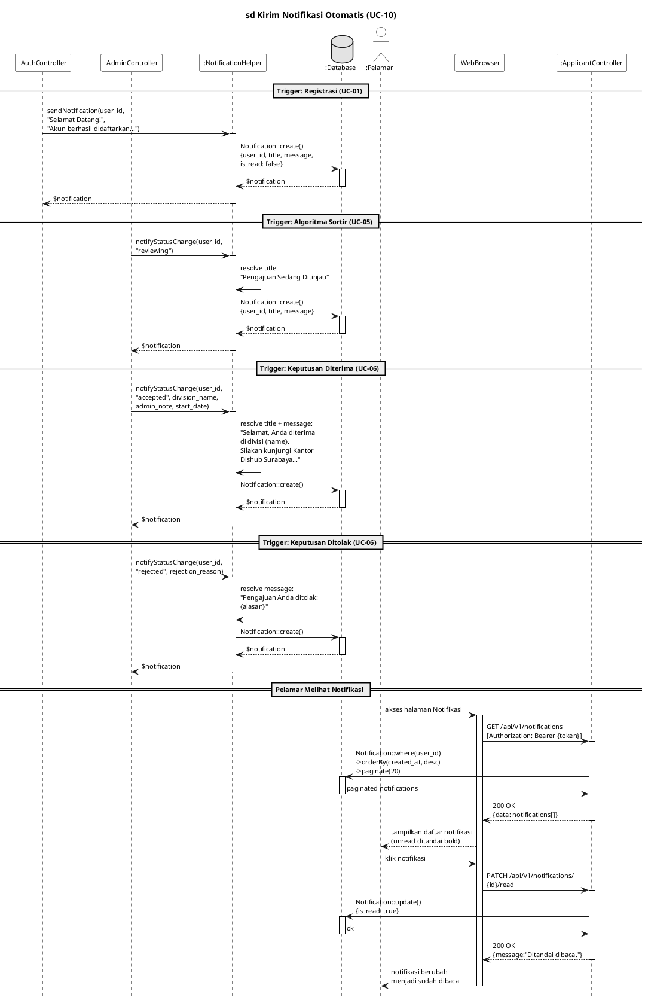

# 10 Sequence Diagram E-Internship — Part 2 (UC-06 s.d. UC-10)

---

## SD-06 · UC-06 – Ubah Status Kelulusan

### Kalimat Pengantar

Diagram *sequence* berikut menggambarkan skenario UC-06 (Ubah Status Kelulusan), di mana AdminController memperbarui status pengajuan menjadi *accepted* atau *rejected*, mengurangi kuota divisi melalui increment('active_applicants') dan mengevaluasi penguncian otomatis via evaluateR5() jika diterima, serta memicu pengiriman notifikasi hasil keputusan kepada pelamar melalui notifyStatusChange().

### PlantUML

---

## SD-07 · UC-07 – Kelola Kuota Divisi

### Kalimat Pengantar

Diagram *sequence* berikut menggambarkan skenario UC-07 (Kelola Kuota Divisi), di mana AdminController menampilkan statistik seluruh divisi beserta jumlah pelamar per-status, memperbarui batas kuota maksimal melalui UpdateDivisionRequest, dan mengevaluasi penguncian otomatis divisi melalui evaluateR5() apabila jumlah peserta aktif telah mencapai kapasitas yang ditetapkan.

### PlantUML

---

## SD-08 · UC-08 – Tinjau Dasbor Analitik

### Kalimat Pengantar

Diagram *sequence* berikut menggambarkan skenario UC-08 (Tinjau Dasbor Analitik), di mana HeadController mengambil data statistik agregat mencakup total pelamar per-status, distribusi per-divisi, *breakdown* tipe pelamar, tren bulanan 12 bulan terakhir, serta persentase kapasitas divisi untuk ditampilkan dalam grafik interaktif pada *dashboard* Pimpinan Bidang.

### PlantUML

---

## SD-09 · UC-09 – Ekspor Rekap Data

### Kalimat Pengantar

Diagram *sequence* berikut menggambarkan skenario UC-09 (Ekspor Rekap Data), di mana HeadController memfilter data pengajuan sesuai parameter yang dipilih Pimpinan Bidang (status, divisi, rentang tanggal, tipe pelamar), membangkitkan file .xlsx berformat laporan 17 kolom menggunakan PhpSpreadsheet, dan mengirimkannya sebagai BinaryFileResponse yang terunduh langsung ke perangkat pengguna.

### PlantUML

---

## SD-10 · UC-10 – Kirim Notifikasi Otomatis

### Kalimat Pengantar

Diagram *sequence* berikut menggambarkan skenario UC-10 (Kirim Notifikasi Otomatis), di mana fungsi helper global sendNotification() dan notifyStatusChange() dipanggil oleh berbagai *controller* pada setiap perubahan status pengajuan untuk menyimpan rekaman notifikasi ke *database* dan menampilkannya secara *real-time* pada halaman notifikasi pelamar melalui ApplicantController::notifications().

### PlantUML

