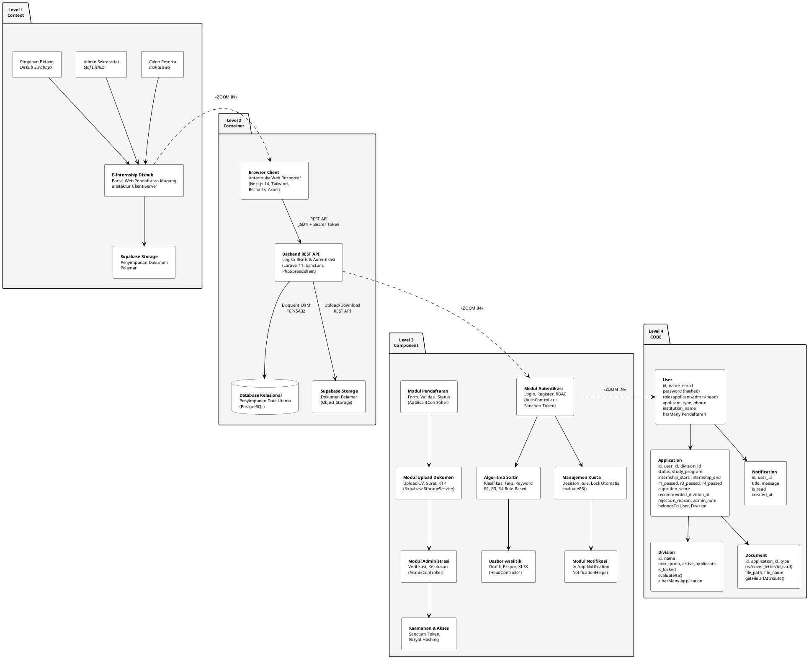
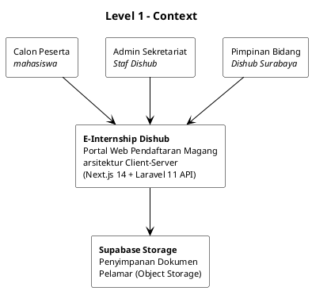
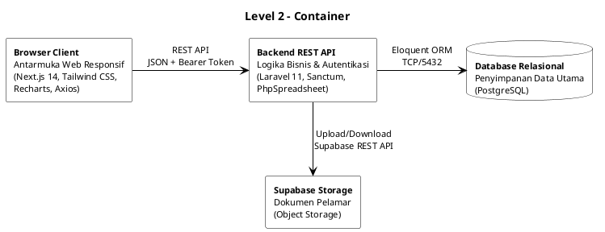
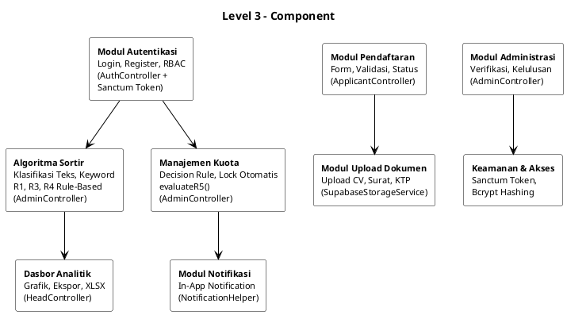
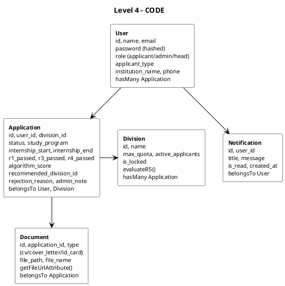

# Software Architecture Diagram (Koreksi) — Gaya Template SRS

> Paste kode di bawah ke [plantuml.com](https://www.plantuml.com/plantuml/uml), unduh PNG, ganti diagram lama di SRS.

## Diagram Gabungan 4 Level (1 Gambar)

---

## Versi Terpisah (Jika Diagram Gabungan Terlalu Padat)

Jika diagram gabungan di atas terlalu kecil saat di-render, gunakan **4 diagram terpisah** berikut:

### Level 1 – Context

### Level 2 – Container

### Level 3 – Component

### Level 4 – Code (Entity / Model)

