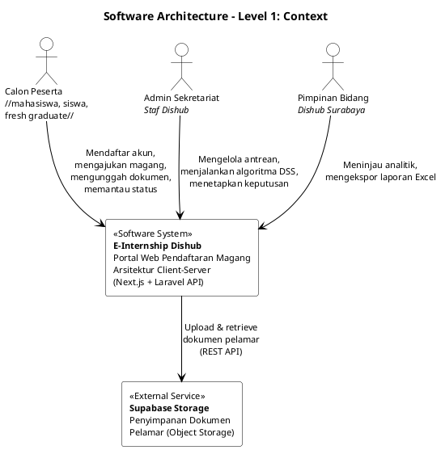
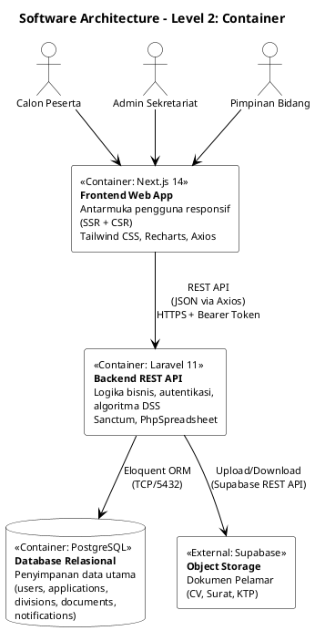
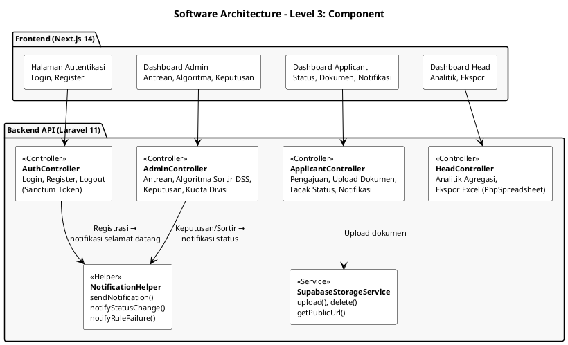
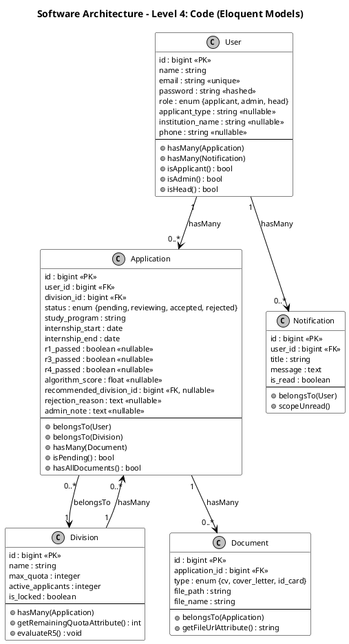

# Review Software Architecture Diagram vs Implementasi Aktual

## Daftar Ketidaksesuaian

| No | Level | Di Diagram Lama | Seharusnya (Kode Aktual) | Keparahan |
|---|---|---|---|---|
| 1 | **L1** | "arsitektur Monolithic" | **Arsitektur Client-Server (Separated):** Next.js 14 (Frontend) + Laravel 11 (Backend API) berkomunikasi via REST API | 🔴 Kritis |
| 2 | **L1** | "Email Service – Notifikasi SMTP" | **Tidak ada SMTP.** Notifikasi bersifat *in-app* saja, disimpan ke tabel `notifications` di database | 🔴 Kritis |
| 3 | **L2** | "Aplikasi Web Monolithic, Server-side Rendering (MVC)" | **2 container terpisah:** (1) Next.js Frontend (SSR/CSR) (2) Laravel API Backend (RESTful) | 🔴 Kritis |
| 4 | **L2** | "File Storage" (generik) | **Supabase Storage** (bucket object storage via REST API) | 🟡 Minor |
| 5 | **L3** | "Keamanan & Akses: HTTPS, hashing session" | **Laravel Sanctum (Token-based Auth),** bukan session-based. Password di-hash via bcrypt | 🟠 Sedang |
| 6 | **L3** | "Modul Notifikasi: Email SMTP, Status Berkas" | **NotificationHelper (In-App):** sendNotification(), notifyStatusChange(), notifyRuleFailure() — tanpa email SMTP | 🔴 Kritis |
| 7 | **L4** | Tabel "Surat Persetujuan" (pendaftaran_id, nomor_surat, tgl_terbit, admin_id) | **Tidak ada tabel ini** di database. Keputusan admin disimpan di kolom `admin_note` dan `rejection_reason` pada tabel `applications` | 🔴 Kritis |
| 8 | **L4** | User: role (pelamar/admin) | Role ada 3: **applicant, admin, head** | 🟠 Sedang |
| 9 | **L4** | User: tanpa applicant_type, institution_name, phone | Field ada: **applicant_type, institution_name, phone** | 🟠 Sedang |
| 10 | **L4** | "Pendaftaran Pendaftaran": divisi_id, status, tgl_daftar, skor_algoritma | Nama tabel: **Application** dengan field tambahan: **study_program, internship_start, internship_end, r1_passed, r3_passed, r4_passed, recommended_division_id, rejection_reason, admin_note** | 🟠 Sedang |
| 11 | **L4** | "E-Internship Dishub": kuota_terisi, keyword_keahlian | Nama tabel: **Division** — field aktual: **name, max_quota, active_applicants, is_locked** (tanpa keyword_keahlian) | 🟠 Sedang |
| 12 | **L4** | Document: pendaftaran_id, tipe, path_file | Field aktual: **application_id, type, file_path, file_name** + accessor **file_url** | 🟡 Minor |

---

## Diagram Koreksi — 4 Level (PlantUML)

### Level 1: Context Diagram

### Level 2: Container Diagram

### Level 3: Component Diagram

### Level 4: Code Diagram (Model/Entity)

